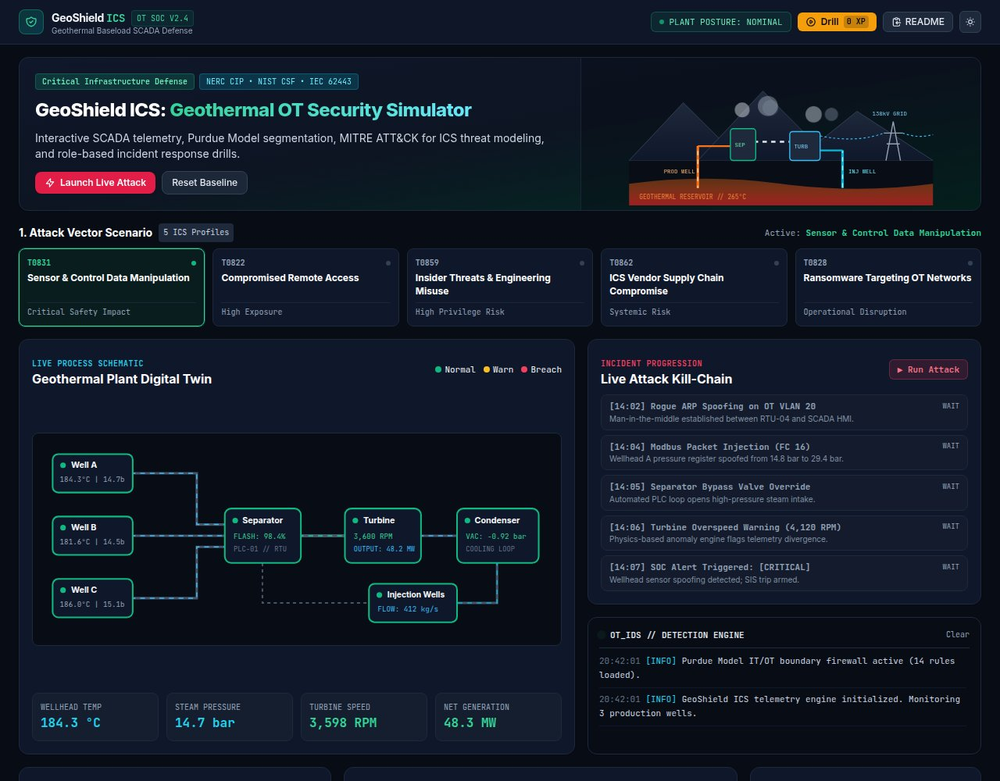
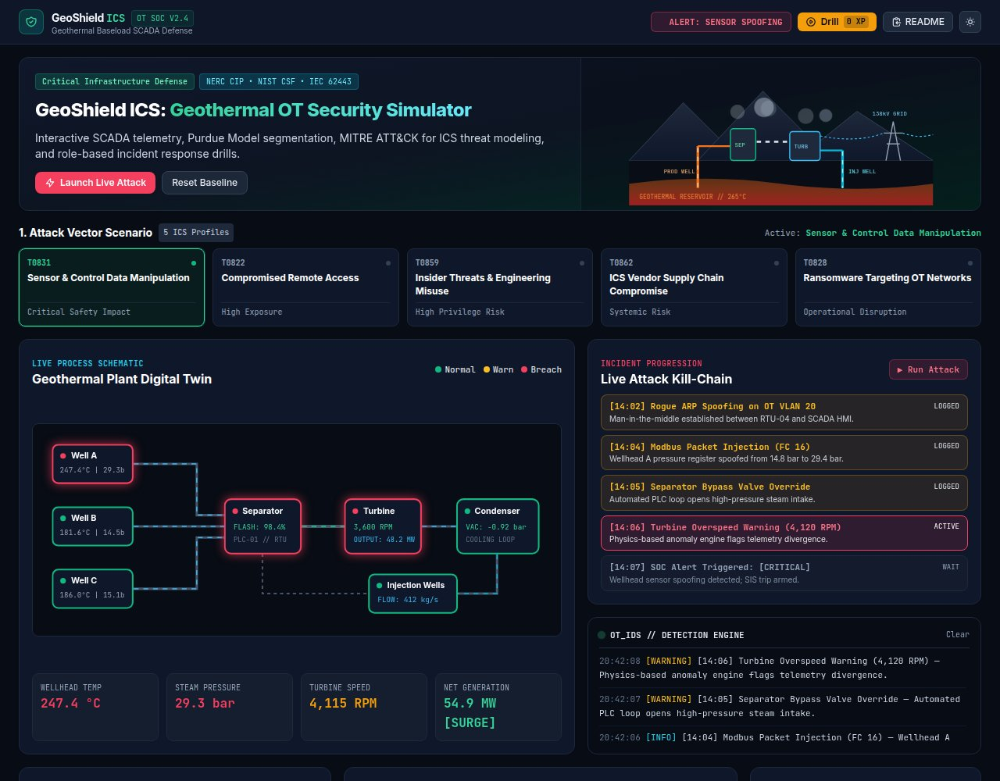
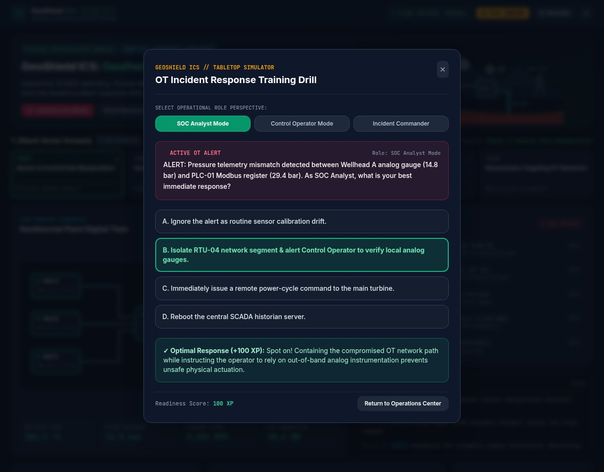
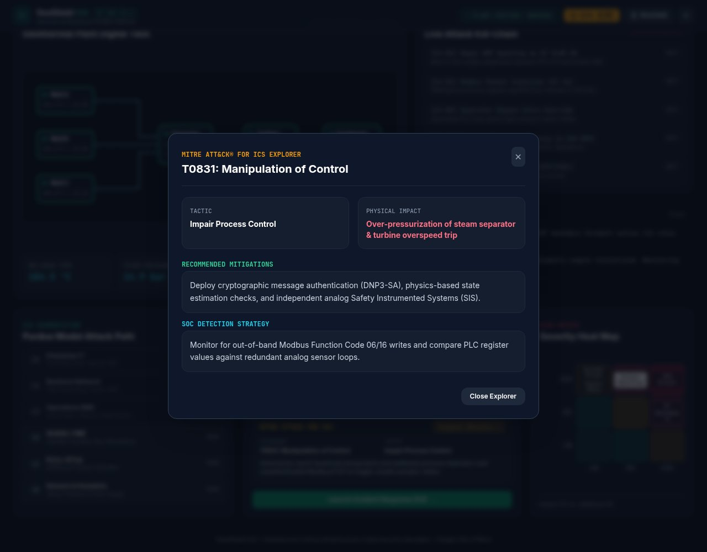

# GeoShield ICS — Geothermal Power Plant Cybersecurity Simulator

An interactive geothermal power plant cybersecurity training simulator in a single HTML file. It teaches industrial control system (ICS/OT) defense through simulated SCADA telemetry, Purdue Model segmentation, MITRE ATT&CK for ICS threat modeling, and role-based incident response drills.

Everything is simulated. There is no live plant data, no connection to real control systems, and no real industrial equipment involved. All telemetry values are generated in the browser.



## What it does

- **Geothermal plant digital twin** — an animated process schematic tracking three production wells, a steam separator, a turbine generator, a condenser, and reinjection wells, with live drifting telemetry (wellhead temperature, steam pressure, turbine speed, net generation).
- **Five OT attack scenarios** — each with a kill-chain timeline, Purdue Model traversal path, affected plant nodes, and SOC detection feed entries. Launching an attack drives the twin, the metrics, and the plant posture indicator into anomalous states; Reset restores the nominal baseline.
- **Framework mapping** — every scenario maps to MITRE ATT&CK for ICS, NIST CSF 2.0 functions, and IEC 62443 requirements, with mitigations and detection guidance in the ATT&CK explorer.
- **Severity heat map** — likelihood vs. physical/grid impact for all five scenarios; selecting a tag switches the active scenario.
- **SOC detection feed** — a streaming log of INFO, WARNING, and CRITICAL entries as an attack progresses.
- **Role-based training drills** — fifteen scored incident response drills (five scenarios × three roles: SOC Analyst, Control Room Operator, Incident Commander). Each drill presents a realistic OT incident with four response options and immediate feedback. Correct first-time answers earn 100 XP.
- **Light/dark themes**, and a layout that works on phone widths.



## Scenarios

| Scenario | MITRE ATT&CK for ICS | Focus |
|---|---|---|
| Sensor & Control Data Manipulation | T0831: Manipulation of Control | Spoofed Modbus telemetry vs. physical instrumentation |
| Compromised Remote Access | T0822: External Remote Services | Stolen vendor VPN credentials pivoting into SCADA |
| Insider Threats & Engineering Misuse | T0859: Valid Accounts | Unauthorized PLC logic changes and alarm suppression |
| ICS Vendor Supply Chain Compromise | T0862: Supply Chain Compromise | Trojanized turbine governor firmware update |
| Ransomware Targeting OT Networks | T0828: Loss of Productivity & Revenue | HMI/historian encryption with PLCs still running |

The drills emphasize safety, reliability, and physical consequences — how an operator should respond when telemetry conflicts with physical instrumentation — rather than hacking techniques.





## How to run

Open `index.html` in any modern browser. No build step, no server, no install.

Note: the page loads Tailwind CSS and Google Fonts from CDNs, so it needs an internet connection to render styled. It is not offline-first.

## Honest limits

- All telemetry, alerts, and incidents are simulated in the browser. Nothing here monitors or controls real equipment.
- Drill XP is session-only: it resets when the page reloads. There is no saved progress, no accounts, and no backend.
- The simulator teaches concepts and decision-making. It is not a certification, a compliance tool, or a substitute for hands-on OT training.

## Stack

Single-file HTML + vanilla JavaScript. Tailwind CSS and Google Fonts (Inter, JetBrains Mono) via CDN. SVG for the plant schematic and digital twin. No frameworks, no build tools, no dependencies to install.

## Project structure

```
geoshield-ics/
├── index.html          # The entire simulator
├── README.md
├── LICENSE
└── screenshots/        # Captured from the running simulator
```

## License

MIT — see [LICENSE](LICENSE).

Built by Robert Bostick. Part of a cybersecurity portfolio focused on detection, threat modeling, and incident response.
